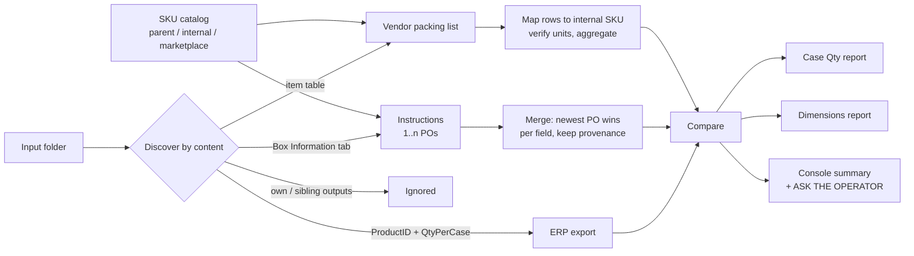

# Packing Spec Validator

Checks every SKU on an inbound shipment against what the ERP says and what the vendor was told: bags per carton and carton size. For each mismatch it tells you whether to update the ERP or go back to the vendor.

[](https://www.python.org/)
[](https://github.com/cristianbarreto08/packing-spec-validator/actions/workflows/ci.yml)
[](LICENSE)

## The problem

When a container arrives from an overseas vendor, three sources describe how each SKU should be packed. The **ERP product master** has its own numbers. The **packing instructions** were sent to the vendor with the PO. The **vendor's packing list** describes what they actually shipped. Someone had to compare them line by line across hundreds of SKUs, and the three sources use different SKU codes and mixed units (mm, cm and inches). The ERP's case-quantity field also went out of date without anyone noticing. A wrong case quantity or carton size flows into marketplace inbound shipments, warehouse labels and reorder math, so a missed mismatch shows up weeks later as rejected cartons or wrong stock counts.

## What it does

- Compares **bags per carton** (case qty) and **carton dimensions** for every SKU in the ERP export, using three sources:
  - the ERP product export,
  - the packing instructions we sent,
  - the vendor packing list.
- Writes **two Excel reports**, one per question. Each row is color-coded:
  - **green**: OK, nothing to do.
  - **amber**: the correct value is known and an ERP field is stale. The *Correct* column holds the value to load.
  - **red**: no source agrees, data is missing, or the vendor ignored our instructions. A person needs to decide.
  - **grey**: the SKU is not on this packing list.
- Handles **several instruction files** (one per PO) for the same container. The newest PO wins field by field, older POs only fill gaps, and a provenance column records which PO each value came from.
- Recognizes input files **by content, not file name**. It skips its own earlier reports and the outputs of sibling tools that have been left in the same folder.
- When the instructions file is missing, it prints a separate **ASK THE OPERATOR** block. In that case the only remaining case-qty source is the ERP field that is known to go stale.
- If the instructions file lacks the internal SKU column, it writes a copy with that column added.

## How it works



1. **Discovery** sorts each workbook in the input folder into the ERP export, the instructions files or the packing list. It orders the instructions files by PO number, then by date, and prints that order.
2. **SKU translation.** Vendors only see parent SKUs and marketplace SKUs. The ERP is keyed by an internal SKU (`FBA-HX-1042-P5`). A catalog maps between the three levels.
3. **Packing list.** Each row is mapped to an internal SKU, units are verified, and rows are grouped per SKU, weighted by carton count.
4. **Comparison.** The packing list is the reference because it describes what actually arrived. One agreeing source is enough to know the correct value. Any other source that disagrees is flagged: a stale ERP field is an update, and a vendor deviation needs review.
5. **Reports.** Two formatted workbooks, each with a *Run info* tab listing the inputs, the PO priority order and all warnings.

## Design decisions & edge cases handled

- **Case-qty precedence follows the buyers' existing template.** "Correct case qty" stays in column I and the five match checks (J..N) keep their original order. The checks are live Excel formulas, so a reviewer can see the rule. The decision columns are values, because they apply rules the template never had.
- **A deprecated ERP column that says "Ignore".** It is still shown as-is, but text never equals a number, so it cannot affect the result until the field is removed from the ERP.
- **Vendor deviation is red even when the ERP already agrees with the vendor.** If they shipped 30 bags per carton when we asked for 24, accepting that is a business decision, not data entry. The *Correct* column still shows the value.
- **Multiple POs per container.** The newest PO wins **per field**. If PO 1042 lists a SKU without a carton size, the size comes from PO 1041 and the provenance column says so. Priority is inferred from file names and always printed. Passing `--instructions` repeatedly overrides it, and the order given on the command line is the priority.
- **PO numbers are parsed from file names after stripping dates.** Otherwise `... 2026-09-02.xlsx` turns into "PO 02-09".
- **Finding the internal-SKU column by content.** In vendor files that column often has no header, while a column literally named "FBA SKU" holds marketplace SKUs. The winning column is the one with the most values that exist in the ERP. A match ratio is only used as a minimum, because instruction files list every SKU on the PO, so the correct column can sit near 50%.
- **`#N/A` is not a SKU.** Such rows are resolved by parent + pieces per bag instead. That lookup usually returns two candidates (the FBA- and MF- variants), and the ERP export decides between them. If it can't, the warning lists both candidates. The tool never picks one arbitrarily.
- **Merged SKU cells.** When one SKU ships in two packings, vendors merge the SKU cell over both rows. If merged cells weren't resolved, the second packing would silently disappear. Two packings for the same SKU are shown as a conflict: the value backed by more cartons is shown, the row is red, and both values appear in the note.
- **Unit labels are never trusted.** Files title columns "LENGTH (cm)" while the values are millimetres. The unit is verified against independent signals: the inch columns, the vendor's declared CBM, or the ERP's inch fields. Magnitude is only the last resort. The ERP's free-text size mixes mm and cm within one export and contains dates ("Confirmed 08/07/2026") that are removed before parsing.
- **A `0` in the ERP inch fields means "not filled in"**, not a 0 mm side. Treating it as a size would create false mismatches.
- **Carton tolerance (default 5 mm).** Differences up to 5 mm count as vendor rounding. If the sides only match in a different order, it is the same carton, but it is flagged so the ERP stores the axes in the vendor's order.
- **Nothing is fixed silently.** If a packing-list SKU is missing from the ERP export, if a marketplace SKU can't be translated, or if quantity ≠ pcs/bag × bags/carton × cartons, it is listed as a warning in the console and in the *Run info* tab.

## Impact

Replaces a manual multi-hour, line-by-line cross-check of three spreadsheets per inbound container with a single run. Every flagged row comes with a reason and the source rows behind it. In production it found stale ERP case quantities and carton dimensions that had looked fine for a long time, because the ERP agreed with itself and only the instructions file could contradict it. It also separates fixes the buyer can make alone (amber) from conversations with the vendor (red).

## Quickstart

```bash
git clone https://github.com/cristianbarreto08/packing-spec-validator.git
cd packing-spec-validator
python -m venv .venv && source .venv/bin/activate
pip install -e .[dev]

python examples/generate_sample_data.py   # regenerate synthetic inputs (already committed)
packing-spec demo                         # writes the reports to output/
pytest -q                                 # run the tests
```

Run on your own files:

```bash
# discover inputs in a folder
packing-spec run --input-dir path/to/input --catalog path/to/sku_catalog.xlsx --vendor "Vendor A"

# or pass files explicitly; --instructions order IS the priority (first wins)
packing-spec run --catalog sku_catalog.xlsx --erp erp_export.xlsx \
  --packing-list "packing list PO 1041-1042.xlsx" \
  --instructions "Instructions PO 1042.xlsx" --instructions "Instructions PO 1041.xlsx"
```

Options: `--pl-sheet` forces the packing-list tab, `--po` overrides the PO label used in output names, `--tolerance-mm` changes the carton tolerance and `--out` sets the output folder.

## Sample output

Console summary from `packing-spec demo` (15 SKUs, two instruction files, one packing list, two decoy files that are ignored):

```
  CASE QTY (bags per carton): 15 SKUs        CARTON DIMENSIONS: 15 SKUs
    OK           10                            OK           9
    UPDATE       1                             UPDATE       3
    REVIEW       3                             REVIEW       2
    NOT SHIPPED  1                             NOT SHIPPED  1
```

Excerpt of the **Case Qty** report:

| Product ID | QtyPerCase (ERP) | Instructions we sent | Source | PL case qty | Correct case qty | Status | What to do |
|---|---|---|---|---|---|---|---|
| FBA-HX-1042-P5 | 40 | 40 | PO 1042 | 40 | 40 | OK | packing list matches the instructions we sent |
| MF-HX-1042-P20 | 12 | 10 | PO 1042 | 10 | 10 | UPDATE | ...but ERP QtyPerCase is stale: it says 12, correct value is 10 |
| FBA-CC-2210-P10 | 24 | 24 | PO 1042 | 30 | | REVIEW | vendor did NOT pack as instructed [PO 1042]: asked for 24 bags/carton, shipped 30 |
| FBA-MB-3305-P25 | 60 | 60 | PO 1041 | 60 | | REVIEW | vendor shipped this SKU with MORE THAN ONE carton packing (60 bags/carton in 5 carton(s) and 48 bags/carton in 2 carton(s)) |
| FBA-HX-1042-P10 | 30 | | | 36 | | REVIEW | matches no source: packing list=36, instructions=(blank), ERP=30, custom column='Ignore' |

Excerpt of the **Dimensions** report:

| Product ID | ERP size text | ERP inches vs PL | Instructions (mm) | PL carton (mm) | Correct (mm) | Status | What to do |
|---|---|---|---|---|---|---|---|
| FBA-GR-4400-P6 | 45 x 32 x 34 Accurate | match | 450\*320\*340 | 450\*320\*340 | 450\*320\*340 | OK | ERP size text was in CENTIMETRES; converted to mm |
| FBA-WB-6001-P2 | 620 x 410 x 380 - Confirmed 08/07/2026 | NO match | 620\*410\*380 | 620\*410\*380 | 620\*410\*380 | UPDATE | carton confirmed by the ERP size text; UPDATE CaseLength/Width/Height to 620\*410\*380 mm |
| FBA-LB-3030-P3 | 400 x 300 x 300 | NO match | 450\*320\*210 | 450\*320\*210 | 450\*320\*210 | UPDATE | carton confirmed by the carton we asked for; UPDATE SUPPLIERCASEDIMENSIONS and CaseLength/Width/Height |
| FBA-GR-4400-P12 | 520 x 360 x 300 Confirmed | match | 500\*350\*300 | 520\*360\*300 | 520\*360\*300 | REVIEW | vendor did NOT use the carton we asked for [PO 1042] |
| FBA-HX-1042-P10 | - | | | 500\*340\*260 | | REVIEW | ERP has no usable carton size; vendor says 500\*340\*260 mm - confirm with the vendor, then load it |

## Project structure

```
packing-spec-validator/
├── src/packing_spec/
│   ├── cli.py            # `packing-spec run` / `packing-spec demo`
│   ├── pipeline.py       # end-to-end run, summary, ASK THE OPERATOR block
│   ├── discovery.py      # classify input workbooks by content, skip decoys
│   ├── po_tags.py        # PO numbers / dates from file names, priority order
│   ├── erp.py            # ERP product export reader
│   ├── catalog.py        # parent / internal / marketplace SKU bridge
│   ├── instructions.py   # Box Information reader + newest-PO-wins merge
│   ├── packing_list.py   # vendor packing list: SKU resolution, units, aggregation
│   ├── dims.py           # unit resolution, tolerance, box comparison
│   ├── compare.py        # case-qty precedence and dimension verdicts
│   ├── report.py         # formatted Excel outputs
│   ├── sheet_utils.py    # header/content-based column detection, merged cells
│   └── models.py         # dataclasses and Status enum
├── examples/
│   ├── generate_sample_data.py   # seeded synthetic data generator
│   └── sample_data/              # committed synthetic inputs (input/, reference/)
├── tests/                         # pytest: units, merge rules, end-to-end runs
├── pyproject.toml
└── .github/workflows/ci.yml
```

## Tech stack

Python 3.11+, openpyxl (reads and writes Excel, including live formulas, cell comments and conditional fills), pytest, ruff, GitHub Actions. It works with exports from any ERP (e.g. SellerCloud) and with vendor spreadsheets in any column order.

## About this repo

Generalized rewrite of a production tool I built and run at a US e-commerce brand that sells mainly on Amazon (800+ SKUs). All data here is synthetic. Company-specific names, systems and data were removed.

**Cristian Barreto**, Operations Automation Specialist, E-commerce & Supply Chain
[GitHub](https://github.com/cristianbarreto08) · [LinkedIn](https://www.linkedin.com/in/cristianbarreto13) · [Portfolio](https://cristianbarreto08.github.io)
